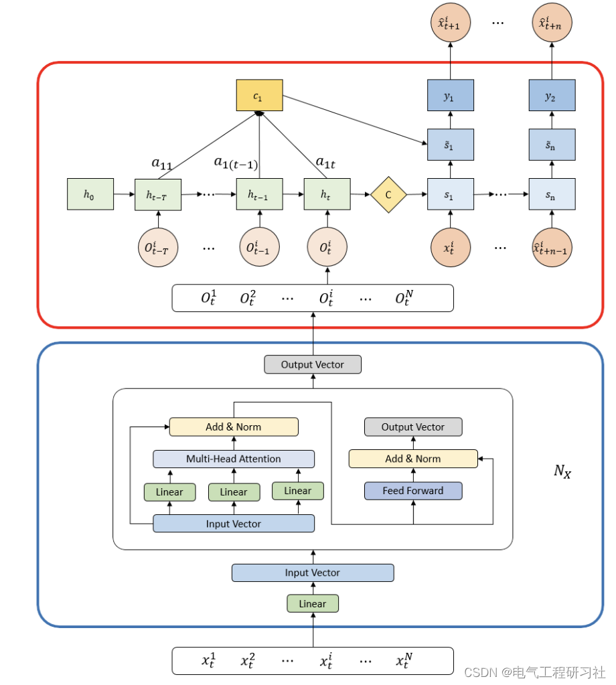
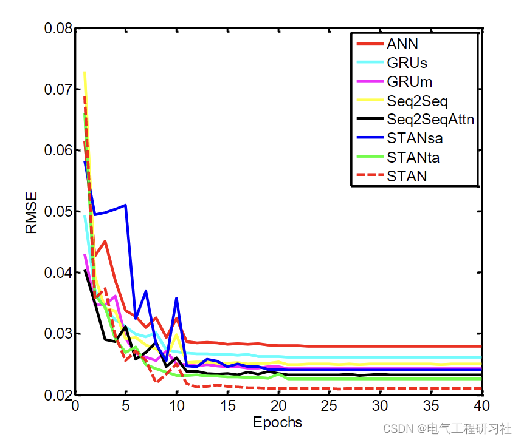
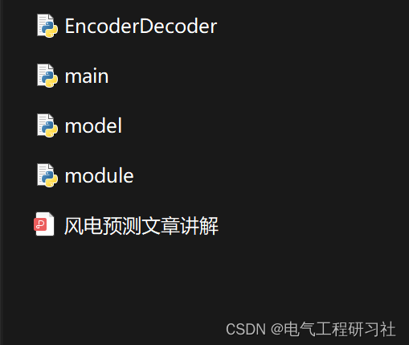

# Wind Power Forecasting Based on STAN (Python Code Implementation)

[Precautionary Instruction]: The Python code in this article requires the use of your own dataset.
📋📋📋This article's directory is as follows:⛳️⛳️⛳️​Directory 1: Overview
[Abstract]: Wind power is one of the most important renewable energy sources, and accurate wind power forecasting is of great significance for reliable and economical power system operation and control strategies. This paper presents a novel wind power generation prediction framework with Spatio-Temporal Attention Network (STAN). This model captures the spatial correlation between wind farms and the temporal dependency of wind power time series. Firstly, we employ multi-head self-attention mechanisms to extract the spatial correlation between wind farms. Then, a sequence-to-sequence (Seq2Seq) model with global attention mechanism captures the temporal dependency. Finally, experimental results show that our model achieves better performance than other baseline methods. Wind power plays an extremely important role in the global power grid. Due to its variability and randomness, it is difficult to establish models and accurately predict wind power [1]. We not only need to capture the temporal dependency relationship but also construct the spatial correlation between target wind farms and some other wind farms. Wind power power prediction has attracted great attention from researchers. Some researchers use statistical methods for short-term wind power prediction. Statistical models include historical average (HA) method and autoregressive moving average (ARMA) method [2^3]. ARMA is the most famous time series-based method for future value prediction of wind power, and researchers have tried some ARMA variants (such as ARIMA) to achieve better prediction performance. However, these methods are limited by the assumption that the target time series is a stationary stochastic process [3]. Unfortunately, wind power does not conform to this assumption in reality.
Additionally, Long Short-Term Memory (LSTM) and Gated Recurrent Units (GRU) are two special variants of RNN. On the one hand, these methods have achieved success in many fields including Natural Language Processing (NLP) and time series prediction. On the other hand, their drawback is that they do not fully consider the spatial dependencies between wind farms. In neural networks, Convolutional Neural Networks (CNN) models are effectively used to model the spatial dependencies for image classification, visual recognition, and traffic flow prediction [7]. However, CNNs are adept at processing data with a grid-like topology, such as images [8]. In other words, when we model the non-Euclidean correlation between different wind farms, CNNs cannot work well.
2 Mathematical Model
Context vectors capture relevant information from the encoder to predict future values. The difference between Seq2Seq models and attention-enabled Seq2Seq models lies in that the attention mechanism dynamically calculates the context vector for each timestamp. This calculation is done by taking the weighted average of all hidden states of the encoder, as shown below:
Where ∈ℝ1×n is an element of the weight vector, and ​ is calculated as follows:
Detailed mathematical model can be found in Section 4.
3 Simulation Results
4 Python Code and Article Explanation
All code and article explanation can be found here:
Edit
5 End Note
Theoretical references to network literature, if any infringement, please contact the blogger to delete.

## Images

<!-- PAYMENT_BLOCK -->

## Get this dataset

- Payment link (Stripe): [Buy now](https://buy.stripe.com/3cs8yP7sY87d0vu9AB)
- Payment QR code: 

<!-- /PAYMENT_BLOCK -->
